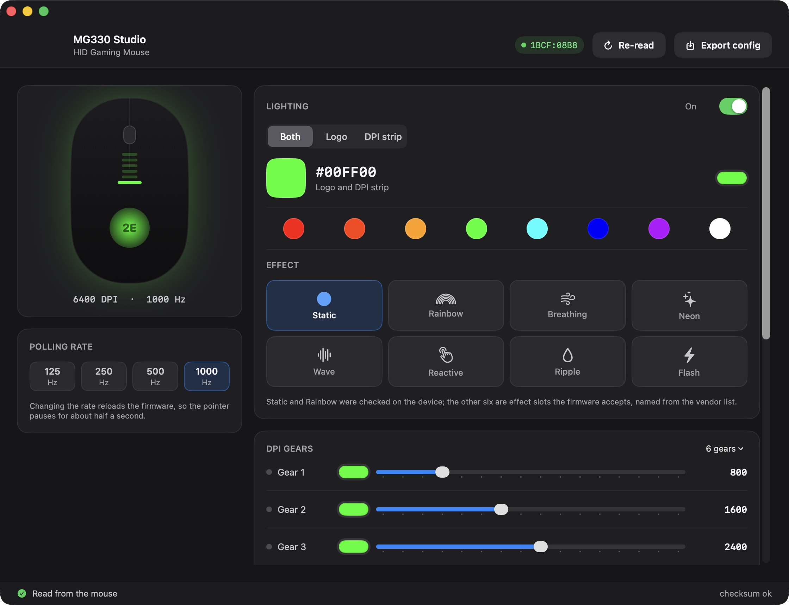
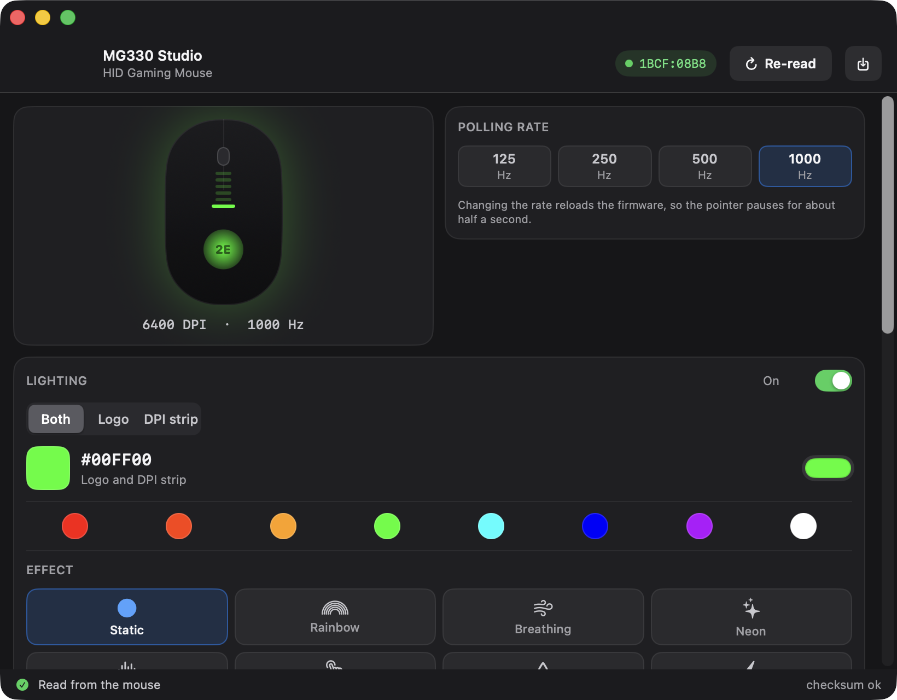

# MG330 Studio

[](https://github.com/ismoilovdevml/spcp6651-studio/actions/workflows/build.yml)

Lighting, DPI and polling-rate control for Sunplus **SPCP6651B** gaming mice on macOS —
developed and verified on the **2E Gaming MG330 RGB** (`2E-MG330UB`, USB `1BCF:08B8`).

2E ships configuration software for Windows only. MG330 Studio talks to the mouse directly
over IOKit HID, using the same feature-report protocol the firmware expects, recovered from
the vendor's own driver. It reads the mouse's real 2 KB configuration on launch, so what
the window shows is what the device holds — not a guess at the factory defaults.



> The repository is named after the controller, `spcp6651-studio`, because the protocol
> belongs to the chip rather than to one mouse — but the MG330 is the only model it has
> been tested on. If you try it on another SPCP6651B mouse, please open an issue and say
> what happened.

## What it does

- **Two independent RGB zones** — the palm-rest logo and the DPI strip under the wheel,
  set together or separately
- **Eight effect slots** — Static and Rainbow verified on the device; the other six are
  slots the firmware accepts, named from the vendor's list
- **DPI per gear** — 16 steps, with the six factory stages labelled from 2E's published
  values (800/1600/2400/3200/4800/6400) and the rest marked as inferred
- **Gear count, active gear, and a colour per gear** for the indicator strip
- **Polling rate** — 125 / 250 / 500 / 1000 Hz
- **Reads back what it wrote** — a verification read runs once you stop changing things,
  and the config checksum the firmware does not maintain is repaired for it
- **Config export** — the whole 2 KB image, so you have a record before you experiment

The window has two layouts. Resize it below 980×780 and it switches to a compact one:



Button remapping is **read-only**. The slot table is decoded — three profiles of twelve
4-byte slots — and the app shows each action, but which physical button a slot drives was
never established, and a wrong value there can leave a button dead. Reading only, for now.

## Requirements

- macOS 14 or later
- A Sunplus SPCP6651B mouse — tested on the 2E MG330 (`1BCF:08B8`)
- **Input Monitoring**, granted to the app in System Settings › Privacy & Security

The app does *not* seize the device, so the mouse keeps working normally while it runs.
A seized open is in fact refused by this device; a plain open plus feature reports is all
it needs. Opening a HID device on macOS still requires Input Monitoring, and without it
the app reports `kIOReturnNotPermitted` and tells you what to do.

## Build

```sh
./build.sh            # build to build/Release
./build.sh install    # also copy to /Applications and launch
```

Requires Xcode 16.

The Input Monitoring grant is bound to the code signature, so **use a stable signing
identity** — an ad-hoc signature changes on every build and the grant does not follow it,
leaving the app unable to open the device even though it is ticked in System Settings.
Create one once in Keychain Access (*Certificate Assistant › Create a Certificate*, type
*Code Signing*, set to *Always Trust*), then:

```sh
export MG330_SIGN_IDENTITY="MG330Studio Local Signing"
```

## The protocol

Everything moves in 8-byte HID feature reports. Report `0x40` carries commands, `0x41`
carries bulk data.

| Operation | Report | Bytes |
|---|---|---|
| write 1–3 bytes | `0x40` Set | `40 05 00 ADDR v0 v1 v2 COUNT` |
| block read | `0x40` Set | `40 09 addrHi addrLo lenHi lenLo 00 00`, then repeated `0x41` Get, 7 data bytes each |
| block write | `0x40` Set | `40 07 addrHi addrLo lenHi lenLo 00 00`, then repeated `0x41` Set |
| reload firmware | `0x40` Set | `40 0e 00 00 00 00 00 00` |

The device holds a 2 KB config image addressed directly by the write primitive: colours at
`0x39` and `0x57`, DPI at `0x2B`–`0x2F`, polling bits in `0x04` and `0x08`, the effect at
`0xA5`, the active gear at `0xA6`. Every checksummed region is **sum of the bytes, XOR
`0x5A`** — all five checksums in a live image reproduce exactly, which is what pins the
layout.

Setting a DPI step is not enough on its own: the firmware re-reads the value only when the
active gear changes, so the app writes `0xA6` with a neighbouring gear and then back — the
same bump the vendor driver performs.

The full map, the decompiled call trail and the experiments behind it are in
[docs/protocol.md](docs/protocol.md).

## Known limits

**An abandoned block read wedges the config channel.** This is the one real hazard, and it
was isolated by experiment rather than guessed at. Reads alone are safe (25 consecutive
352-byte reads passed, with and without reopening the device between them), and so are
writes (120 back-to-back single-byte writes; 10 full colour-change cycles of 16 writes plus
a read). What breaks it is collecting only part of a stream: taking 3 chunks of 51 and then
starting anything else leaves the channel answering `kIOReturnTimeout` to **everything**,
reads and writes alike. Nothing recovers it in software — the reload command cannot be
delivered, because delivering it is itself a write; draining does not help; closing and
reopening the device does not help. Only unplugging the mouse does, and the pointer keeps
working throughout.

So the app never interrupts a read — no cancellation check, no per-chunk retry — all device
access is serialised, and the routine verification read is kept to the chunks it needs.
The corollary for users: **do not run another tool against the mouse while the app is
open.** Two processes interleaving their streams reproduce exactly this failure.

Also worth knowing:

- **Colour changes persist.** A colour written through the app was still there after a full
  unplug, so these writes reach non-volatile storage. A replug is not an undo path —
  export the config first if you want a way back. Whether every other field behaves the
  same way was not measured.
- **Screen colours are not device colours.** The LEDs are much brighter in green and blue
  than in red, so `#30D158` arrives looking mint. The presets are saturated channel mixes
  for that reason.
- Effects 2–7 are accepted by the firmware but their appearance was not checked.
- Macros and the "fire key" are not implemented.

## Licence

MIT — see [LICENSE](LICENSE). Third-party notes in [THIRD-PARTY.md](THIRD-PARTY.md).

2E, MG330 and Sunplus are trademarks of their respective owners. This project is not
affiliated with or endorsed by any of them.
